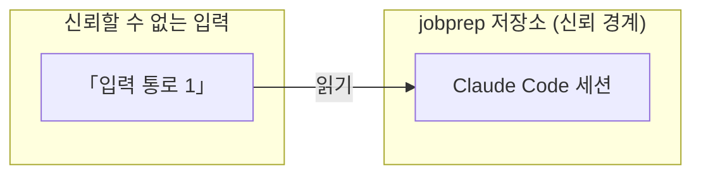

# jobprep 운영 에이전트 시스템 위협 모델

- 작성: 「이름」 · 작성일: 「YYYY-MM-DD」 · 판: v1.0
- 범위: `jobprep` 저장소와 그 저장소를 운영하는 에이전트(Claude Code 세션, 서브에이전트, MCP 서버 「이름」, 훅)
- 근거: OWASP Top 10 for LLM Applications 2025·2026, OWASP Top 10 for Agentic Applications 2026, STRIDE, `security/결과기록.md`

## 1. 무엇을 다루는가 (시스템 모델)

> 위 그림을 고쳐 입력 통로, 에이전트, 도구, 자산, 바깥으로 나가는 통로를 모두 그린다. 신뢰 경계를 넘는 화살표에 번호를 붙인다.

## 2. 자산

| ID | 자산 | 어디에 있는가 | 새면(망가지면) 생기는 일 |
|---|---|---|---|
| AS1 | 「」 | 「」 | 「」 |

## 3. 진입점 (신뢰할 수 없는 입력)

| ID | 진입점 | 누가 글을 넣을 수 있는가 | 에이전트가 읽는 길 |
|---|---|---|---|
| EP1 | 「」 | 「」 | 「」 |

## 4. 위협과 공격 경로

| ID | STRIDE | OWASP(2026년판) | 공격 경로 (진입점 → 도구 → 자산 → 나가는 통로) | 가능성 | 영향 |
|---|---|---|---|---|---|
| T1 | 「」 | 「」 | 「」 | 「상·중·하」 | 「상·중·하」 |

## 5. 대책

| ID | 대책 | 종류(예방·탐지·대응) | 막는 위협 | 구현 위치 | 확인 방법 |
|---|---|---|---|---|---|
| C1 | 「」 | 「」 | 「」 | 「」 | 「」 |

## 6. 치명적 조합 점검

| 에이전트(세션) | 비공개 데이터 접근 | 신뢰할 수 없는 입력 | 바깥으로 내보내는 수단 | 셋이 모두 있는가 | 끊은 다리와 방법 |
|---|---|---|---|---|---|
| 「」 | 「」 | 「」 | 「」 | 「」 | 「」 |

## 7. 남는 위험

| ID | 남는 위험 | 받아들이는 까닭 | 다시 볼 때 |
|---|---|---|---|
| R1 | 「」 | 「」 | 「」 |

## 8. 사람 승인과 감사 기록

- 사람이 승인하는 지점: 「」
- 남는 기록과 위치: 「」
- 사고가 나면 하는 일(순서): 「」

## 9. 검증

- 재현 결과: `security/결과기록.md` 「요약 한 줄」
- 테스트: `pytest -q` 「결과 마지막 줄」
- 다음 검토 예정: 「YYYY-MM-DD 또는 조건」
