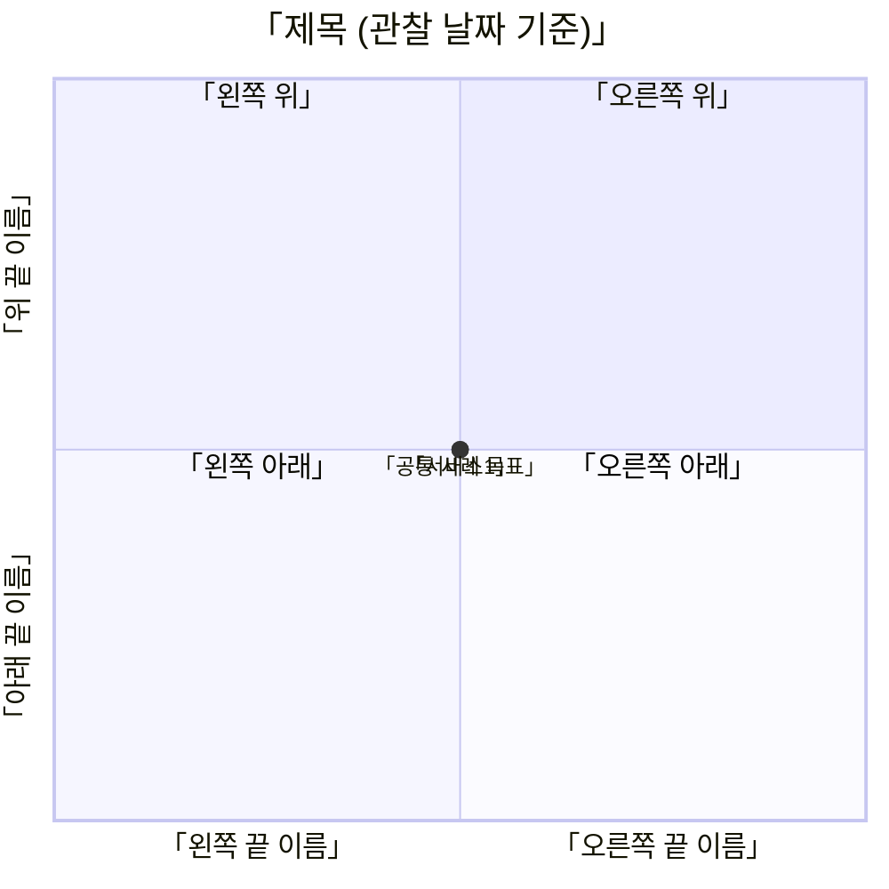

# 포지셔닝 맵: 취업 준비 지원 서비스

- 근거 자료: `경쟁서비스_비교표.md` (「YYYY-MM-DD」 확인)

## 1. 축과 점수 규칙

| 축 | 0에 가까움 | 1에 가까움 | 점수 규칙 |
|---|---|---|---|
| 가로: 「」 | 「」 | 「」 | 「비교표에서 점수를 어떻게 정하는가」 |
| 세로: 「」 | 「」 | 「」 | 「」 |

## 2. 점수

| 서비스 | 가로 점수 | 가로 근거 | 세로 계산 | 세로 점수 |
|---|---|---|---|---|
| 「」 | 「」 | 「」 | 「」 | 「」 |
| 공통 사례 (목표) | 「」 | 「」 | 「」 | 「」 |

## 3. 그림

좌표는 0과 1 사이의 수로 쓴다. 1은 `1`로, 0.5는 `0.5`로 쓴다(`1.0`, `.5`는 mermaid가 읽지 못한다).

## 4. 읽은 것

- 「빈 자리와 붐비는 자리. 빈 자리가 수요를 뜻하는지는 5장에서 확인한다」
