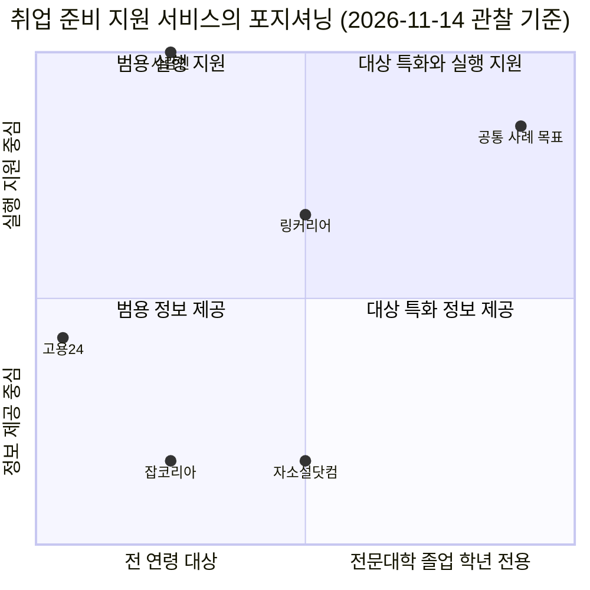

# 포지셔닝 맵: 취업 준비 지원 서비스

- 근거 자료: `경쟁서비스_비교표.md` (2026-11-14 확인)
- 이 그림은 사용자 설문으로 그린 인식 지도가 아니다. 비교표의 관찰을 아래 규칙으로 점수화한 기능 기준의 위치다.

## 1. 축과 점수 규칙

| 축 | 0에 가까움 | 1에 가까움 | 점수 규칙 |
|---|---|---|---|
| 가로: 대상의 범위 | 전 연령·전 경력, 고용 서비스 전반 | 전문대학 졸업 학년 전용 | 0.0 전 국민 고용 서비스, 0.25 전 연령 대상이며 신입·인턴 메뉴가 있음, 0.5 대학생 활동(대외활동, 공모전 등)이 메뉴의 중심, 0.75 특정 학교 유형이나 학년 전용 메뉴가 있음, 1.0 전문대학 졸업 학년 전용 |
| 세로: 지원의 방식 | 정보를 보여 준다 | 지원 과정을 실행하게 돕는다 | 비교표의 실행 지원 6행(공고 스크랩·마감 알림, 이력서 작성·관리, 자기소개서 작성 도구, AI 서류·자기소개서 코칭, AI 모의면접, 지원 현황 관리)에서 ○ 1점, △ 0.5점의 합을 6으로 나눈 값 |

두 축은 서로 독립적인 속성으로 골랐다. 가격과 품질처럼 사용자가 함께 움직인다고 여기는 두 속성을 한 그림에 두면 같은 생각을 두 번 그리게 된다 [P1].

## 2. 점수

| 서비스 | 가로 점수 | 가로 근거 | 세로 계산 | 세로 점수 |
|---|---|---|---|---|
| 사람인 | 0.25 | 신입·인턴 메뉴와 함께 중장년·외국인 채용 메뉴가 있다 | 6 ÷ 6 | 1.00 |
| 잡코리아 | 0.25 | 신입·인턴 메뉴가 있는 전 연령 서비스 | 1 ÷ 6 | 0.17 |
| 링커리어 | 0.50 | 대외활동, 공모전, 동아리, CBT가 메뉴의 중심 | 4 ÷ 6 | 0.67 |
| 자소설닷컴 | 0.50 | 대외활동·공모전, 취준 미션이 첫 화면에 있다 | 1 ÷ 6 | 0.17 |
| 고용24 | 0.00 | 실업급여, 직업훈련, 출산휴가까지 다루는 공공 고용 서비스 | 2.5 ÷ 6 | 0.42 |
| 공통 사례 (목표) | 0.90 | 전문대학 2학년 전용으로 설계한다 | 목표: 6행 중 5행 이상 | 0.85 |

- 잡코리아와 자소설닷컴의 세로 점수가 낮은 것은 첫 화면만 관찰했기 때문일 수 있다. 로그인 뒤 기능을 관찰하면 점수가 바뀐다.
- 공통 사례의 점은 관찰이 아니라 목표다.

## 3. 그림

- 고용24는 가로 점수가 0.00이지만 축 위의 점이 잘 보이지 않으므로 0.05에 그렸다.

## 4. 읽은 것

- 오른쪽 위(대상 특화와 실행 지원)에 관찰된 서비스가 없다. 빈 자리가 곧 수요가 있다는 뜻은 아니다. 수요는 5장의 인터뷰로 확인한다.
- 실행 지원 쪽에서는 사람인이 가장 높다. 공통 사례가 실행 지원만으로 차별화하기는 어렵고, 대상 특화(전문대학 졸업 학년의 일정과 서류)를 함께 갖추어야 한다.

## 출처

| 기호 | 자료 이름 | 주소 | 확인 날짜 |
|---|---|---|---|
| P1 | Perceptual Maps 4 Marketing, 「Perceptual Maps Best Practice」 | https://www.perceptualmaps.com/perceptual-maps-best-practice/ | 2026-11-14 |
