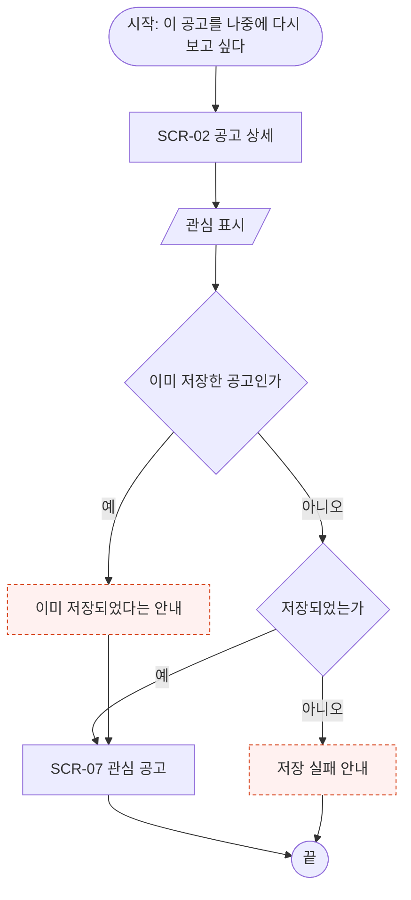
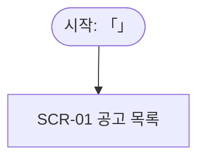
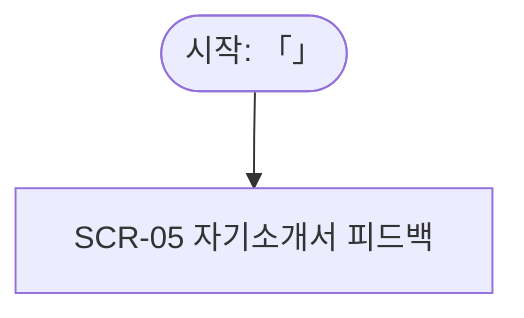

# 사용자 흐름: 취업 준비 지원 서비스 (견본)

<!-- jobprep/docs/설계/사용자흐름.md로 복사해 쓴다. 아래 FLOW-00은 표기를 보이기 위한 작은 흐름이다.
     학습자는 FLOW-01(공고를 찾아 지원 일정에 등록)과 FLOW-02(자기소개서 피드백 받기)를 같은 표기로 쓴다. -->

- 표기: 둥근 칸은 시작과 끝, 네모는 화면, 평행사변형은 사용자의 행동, 마름모는 판단, 빗금 칸(exc)은 예외 처리이다.
- 화면 ID와 요구 ID는 `요구사항명세서.md` v2의 「화면 목록」과 「요구 문장」을 따른다.

## FLOW-00 관심 공고 저장 (표기 견본)

- 행위자와 목표: PS-1 서지후. 나중에 다시 볼 공고를 저장한다.
- 시작: 공고 상세(SCR-02) / 끝: 관심 공고(SCR-07)에 공고가 보인다.
- 관련 요구: REQ-008

| 예외 | 종류 | 처리 | 요구 |
|---|---|---|---|
| 이미 저장한 공고 | 오류(중복) | 이미 저장되었다는 안내, 관심 공고로 이동 | REQ-008 |
| 저장 실패 | 오류 | 저장 실패 안내 | 「없음: 명세의 빈틈. 새 요구 후보」 |

## FLOW-01 공고를 찾아 지원 일정에 등록

- 행위자와 목표: 「」
- 시작: 「」 / 끝: 「」
- 관련 요구: 「」

| 예외 | 종류 | 처리 | 요구 |
|---|---|---|---|
| 「」 | 빈 결과 | 「」 | 「」 |
| 「」 | 오류 | 「」 | 「」 |
| 「」 | 권한 | 「」 | 「」 |

## FLOW-02 자기소개서 피드백 받기

- 행위자와 목표: 「」
- 시작: 「」 / 끝: 「」
- 관련 요구: 「」

| 예외 | 종류 | 처리 | 요구 |
|---|---|---|---|
| 「」 | 오류 | 「」 | 「」 |
| 「」 | 권한 | 「」 | 「」 |

## 흐름을 그리며 찾은 명세의 빈틈

- 「흐름의 예외 가운데 명세에 요구가 없던 것과, 새로 붙인 요구 ID」
