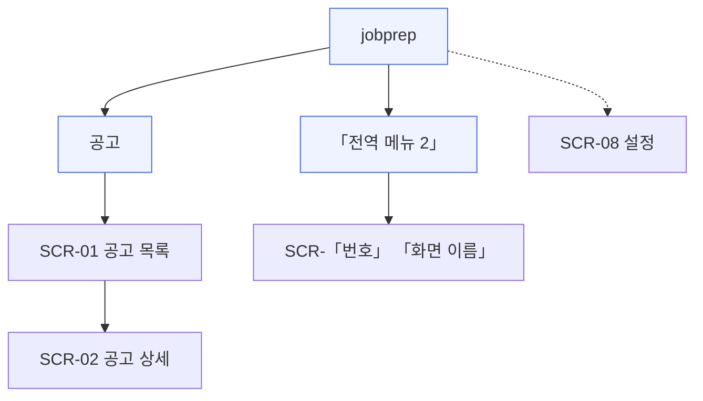

# 정보 구조: 취업 준비 지원 서비스 (견본)

<!-- jobprep/docs/설계/정보구조.md로 복사해 고친다. 아래 사이트맵은 두 갈래만 채운 골격이다.
     나머지 갈래는 카드 소팅 결과(6절 [선택]을 한 경우)나 인터뷰 기록의 말로 채운다. 화면 칸의 레이블은 반드시 「SCR-번호 화면 이름」으로 시작한다. 다 쓴 뒤 이 주석은 지운다. -->

- 근거: 인터뷰 기록(`ch05/기록/`), 카드 소팅 기록 `ch07/카드소팅/기록_짝.md`(6절 [선택]을 한 경우), 여정 지도의 단계, 명세서 v2의 화면 목록
- 조직 체계: 「전역 내비게이션을 무엇으로 나누었는가(과업, 주제, 사용자 집단 등)와 그 까닭」

## 사이트맵

## 내비게이션

| 종류 | 위치 | 항목 |
|---|---|---|
| 전역 | 「」 | 「」 |
| 지역 | 「」 | 「」 |
| 유틸리티 | 「」 | 「」 |
| 맥락 | 「」 | 「」 |

## 레이블

| 레이블 | 바꾸기 전 | 바꾼 까닭 |
|---|---|---|
| 「」 | 「」 | 「카드 소팅이나 인터뷰의 근거」 |

## 검색

- 「무엇을 검색하게 하는가, 결과가 없을 때 무엇을 보이는가(요구 ID)」

## 트리 테스트 (종이, 2명)

<!-- 6절의 [선택] 짝 활동을 하지 않았으면 이 절을 지운다. -->

| 과업 | 정답 위치 | 성공 | 바로 찾음 |
|---|---|---|---|
| 「」 | 「」 | /2 | /2 |
