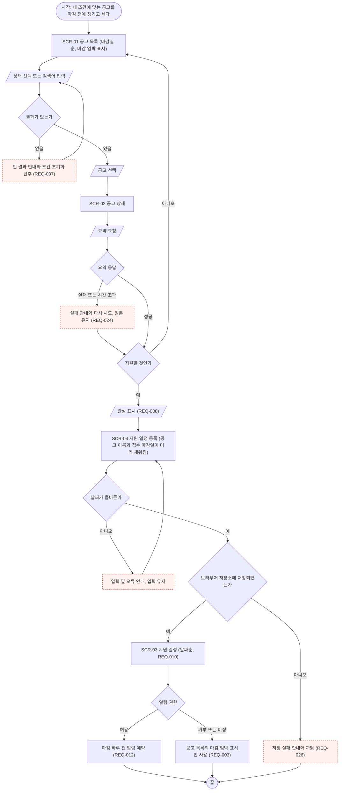
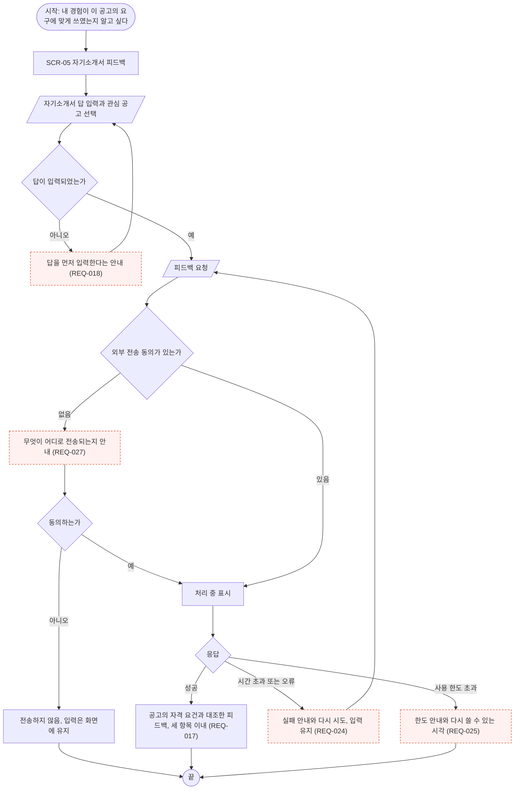

# 사용자 흐름: 취업 준비 지원 서비스

- 표기: 둥근 칸은 시작과 끝, 네모는 화면, 평행사변형은 사용자의 행동, 마름모는 판단, 빗금 칸(exc)은 예외 처리이다.
- 화면 ID와 요구 ID는 `요구사항명세서.md` v2.0의 「화면 목록」과 「요구 문장」을 따른다.

## FLOW-01 공고를 찾아 지원 일정에 등록

- 행위자와 목표: PS-1 서지후. 자기 조건에 맞는 공고를 찾아 마감 시각 전에 지원 일정으로 등록한다.
- 시작: 공고 목록(SCR-01) / 끝: 지원 일정(SCR-03)에 일정이 보인다.
- 관련 요구: REQ-001, REQ-002, REQ-003, REQ-005, REQ-006, REQ-007, REQ-008, REQ-009, REQ-010, REQ-012, REQ-013, REQ-014, REQ-015, REQ-016, REQ-024, REQ-026

| 예외 | 종류 | 처리 | 요구 |
|---|---|---|---|
| 검색 결과 없음 | 빈 결과 | 조건에 맞는 공고가 없다는 안내와 조건 초기화 단추 | REQ-007 |
| 요약 실패, 시간 초과 | 오류 | 실패 안내와 다시 시도, 공고 원문은 그대로 | REQ-024 (v2 추가) |
| 날짜 형식 오류 | 오류 | 입력 칸 옆에 안내, 입력한 값은 지우지 않음 | 요구 없음(8장 화면 명세에서 정함) |
| 저장 실패 | 오류 | 브라우저 설정 때문에 저장할 수 없다는 안내와 까닭 | REQ-026 (v2 추가) |
| 알림 권한 거부 | 권한 | 알림 없이 공고 목록의 마감 임박 표시로 대신함 | REQ-003, REQ-012 |

## FLOW-02 자기소개서 피드백 받기

- 행위자와 목표: PS-2 임하람. 자기 경험을 쓴 자기소개서 답이 공고의 요구에 맞는지 피드백을 받는다.
- 시작: 자기소개서 피드백(SCR-05) / 끝: 피드백이 보이거나, 보내지 않기로 하고 끝낸다.
- 관련 요구: REQ-017, REQ-018, REQ-019, REQ-024, REQ-025, REQ-027

| 예외 | 종류 | 처리 | 요구 |
|---|---|---|---|
| 답이 비어 있음 | 오류(입력) | 답을 먼저 입력한다는 안내, 요청을 보내지 않음 | REQ-018 |
| 외부 전송 동의 없음 | 권한 | 전송 내용과 목적 안내, 동의하지 않으면 보내지 않음 | REQ-027 (v2 추가) |
| 시간 초과, 서버 오류 | 오류 | 실패 안내와 다시 시도, 입력 유지 | REQ-024 (v2 추가) |
| 사용 한도 초과 | 오류(한도) | 한도 안내와 다시 쓸 수 있는 시각 | REQ-025 (v2 추가) |

## 흐름을 그리며 찾은 명세의 빈틈

- LLM 기능의 응답이 실패하거나 시간 제한을 넘었을 때의 동작이 v1에 없었다. REQ-024로 추가하였다. 몇 초를 기다릴지는 열린 질문 Q-05로 10장에 넘겼다.
- 사용 한도를 넘었을 때의 동작이 v1에 없었다. REQ-025로 추가하였다.
- 브라우저 저장소를 쓸 수 없을 때의 동작이 v1에 없었다. REQ-026으로 추가하였다.
- 자기소개서 답을 외부 모델 제공자에게 보내기 전의 동의가 v1에 없었다. REQ-027로 추가하였다. 인터뷰 기록에 직접의 근거가 없는 설계 판단이므로 13장의 평가에서 확인한다.
