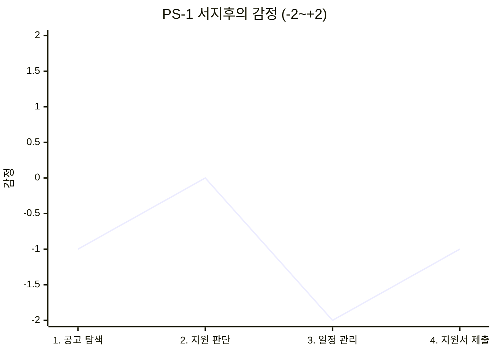

# 사용자 여정 지도: PS-1 서지후

- 행위자: PS-1 서지후 (`ch05/페르소나.md`)
- 시나리오: 전공에 맞는 개발 직무 공고를 찾아 첫 지원서를 제출하기까지 (약 2주)
- 기대: 자기 조건에 맞는 공고만 한곳에서 보고 마감 전날에 알림을 받고 싶다. 짧은 시간에 지원까지 마치고 싶다 [근거: 인터뷰_예시_01:L38] [근거: 인터뷰_예시_01:L40]
- 지도의 종류: 현재 여정(서비스가 없을 때). 미래 여정은 「기회」 행에 적는다.
- 근거 표시: 칸마다 `[근거: 파일:줄]` 또는 `[가정]`. 가정은 다음 사용자 조사에서 확인할 목록이 된다.

## 여정 지도

| 구분 | 1. 공고 탐색 | 2. 지원 판단 | 3. 일정 관리 | 4. 지원서 제출 |
|---|---|---|---|---|
| 행동 | 자기 전에 휴대폰으로 학과 대화방의 공고 링크를 열고, 민간 채용 앱에서 '신입 개발'로 검색한다 [근거: 인터뷰_예시_01:L3] [근거: 인터뷰_예시_01:L5] | 학력 조건과 근무 지역을 먼저 보고, '4년제 졸업'이면 바로 닫는다 [근거: 인터뷰_예시_01:L29] [근거: 인터뷰_예시_01:L30] | 앱의 관심 공고로 저장하지만 다시 모아 보지 않고, 마감일은 적지 않고 앱 알림을 기다린다 [근거: 인터뷰_예시_01:L12] [근거: 인터뷰_예시_01:L13] | 지난 학기에 쓴 자기소개서를 복사해 회사 이름과 몇 문장만 바꾼다 [근거: 인터뷰_예시_01:L20] |
| 생각 | "이게 본 건지 안 본 건지 헷갈린다" [근거: 인터뷰_예시_01:L10] | "요약을 받아도 자격 요건은 원문에서 다시 봐야 한다" [근거: 인터뷰_예시_01:L27] | "주말에 써야지" [근거: 인터뷰_예시_01:L15] | "문항이 회사마다 다른데 다 새로 쓸 시간은 없다" [근거: 인터뷰_예시_01:L21] |
| 감정 (-2~+2) | -1 30분을 찾았는데 지원한 곳이 없다 [근거: 인터뷰_예시_01:L33] | 0 요약은 편했지만 빠진 요건을 원문에서 다시 찾는다 [근거: 인터뷰_예시_01:L27] | -2 마감 시각을 넘겨 지원하지 못한 것을 알았다 [근거: 인터뷰_예시_01:L16] [근거: 인터뷰_예시_01:L17] | -1 첨삭 예약을 아르바이트 때문에 취소하였다 [근거: 인터뷰_예시_01:L23] |
| 접점 | 학과 단체 대화방, 민간 채용 앱 두 개, 채용 관련 즐겨찾기 다섯 곳 [근거: 인터뷰_예시_01:L7] [근거: 인터뷰_예시_01:L9] | 공고 원문, 생성형 AI의 요약 [근거: 인터뷰_예시_01:L26] | 채용 앱의 관심 공고 목록과 앱 알림 [근거: 인터뷰_예시_01:L12] [근거: 인터뷰_예시_01:L13] | 지난 학기의 자기소개서, 학교 취업지원센터, 같은 학과 친구 [근거: 인터뷰_예시_01:L20] [근거: 인터뷰_예시_01:L23] [근거: 인터뷰_예시_01:L24] |
| 불편 | 같은 공고가 여러 곳에 올라와 찾고 거르는 데 시간을 다 쓴다 [근거: 인터뷰_예시_01:L10] [근거: 인터뷰_예시_01:L32] | AI 요약에 자격 요건이 빠져 결국 원문을 다시 본다 [근거: 인터뷰_예시_01:L27] | 마감 날짜만 보고 시각을 보지 않아 두 번 놓쳤다 [근거: 인터뷰_예시_01:L16] [근거: 인터뷰_예시_01:L18] | 첨삭 시간이 아르바이트와 겹치고, 친구는 맞춤법만 봐 준다 [근거: 인터뷰_예시_01:L23] [근거: 인터뷰_예시_01:L24] |
| 기회 | 공고를 한 목록에 마감일 순으로 모으고 상태와 검색어로 거른다 (REQ-002, REQ-005, REQ-006 → SCR-01) | 자격 요건을 근거 문장과 함께 요약한다 (REQ-013, REQ-014 → SCR-02) | 공고 상세에서 바로 관심 표시와 일정 등록, 마감 임박 표시와 하루 전 알림 (REQ-003, REQ-008, REQ-010, REQ-012 → SCR-01, SCR-04, SCR-03) | 공고의 요건과 대조한 피드백 (REQ-017 → SCR-05). 첨삭 시간의 제약은 서비스가 풀 수 없다 |

## 감정 곡선

## 가정과 확인할 것

| 번호 | 가정 | 확인 방법 |
|---|---|---|
| 1 | 마감 하루 전 알림이 있으면 서지후는 마감 전에 지원한다. 기록에는 알림을 바란다는 말만 있다 | 다음 인터뷰에서 앱 알림을 받고 실제로 지원한 경험을 묻는다 [근거: 인터뷰_예시_01:L38] |
| 2 | 휴대폰 화면에서 쓰는 사용자가 대부분이다. 근거는 참여자 한 명이다 | 설문 문항을 더한다 [근거: 인터뷰_예시_01:L3] |

## 기회에서 나온 명세 변경

- 3단계의 「공고 상세에서 바로 관심 표시와 일정 등록」은 REQ-008과 REQ-010을 잇는 진입 경로이다. 흐름 FLOW-01에 반영하였다.
- 2단계에서 AI 요약이 요건을 빠뜨린 경험은 REQ-014(근거 문장 표시)가 이미 다룬다. 요약이 실패했을 때의 동작은 v1에 없어 흐름에서 REQ-024로 더하였다.
- 4단계의 첨삭 시간의 제약은 v2에 넣지 않고 범위 밖으로 둔다. 자기소개서를 대신 써 주는 기능도 5장의 문제 정의 P-03이 범위 밖으로 정하였다.
