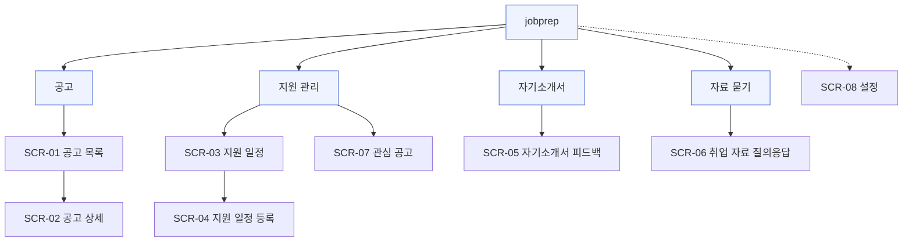

# 정보 구조: 취업 준비 지원 서비스

- 근거: 카드 소팅 기록 `ch07/카드소팅/기록_짝.md`(개방형, 2명), 여정 지도의 단계, 명세서 v2의 화면 목록
- 조직 체계: 전역 내비게이션은 과업 중심(찾기, 관리하기, 준비하기, 묻기), 공고 목록 안은 시간(마감일)으로 정렬하고 상태(접수예정, 접수중, 마감)로 거른다

## 사이트맵

첫 화면은 SCR-01 공고 목록이다. 점선은 유틸리티 내비게이션(모든 화면 오른쪽 위의 설정)이다. 파란 칸은 서비스 이름과 전역 내비게이션의 레이블이며 화면이 아니다.

## 내비게이션

| 종류 | 위치 | 항목 |
|---|---|---|
| 전역 | 좁은 화면은 아래쪽 탭, 넓은 화면은 위쪽 막대 | 공고, 지원 관리, 자기소개서, 자료 묻기 (4개) |
| 지역 | 지원 관리 안의 탭 | 지원 일정, 관심 공고 |
| 유틸리티 | 오른쪽 위 | 설정 |
| 맥락 | 공고 상세 | 「관심 공고에 저장」, 「지원 일정에 추가」 |

## 레이블

| 레이블 | 바꾸기 전 | 바꾼 까닭 |
|---|---|---|
| 지원 관리 | 마이페이지 | 카드 소팅에서 두 사람 모두 "내 일정", "저장한 공고"를 한 묶음으로 만들고 "관리"라고 불렀다 |
| 자료 묻기 | 챗봇 | 기능 이름이 아니라 하는 일로 부른다. "챗봇"은 무엇을 물을 수 있는지 알려 주지 않는다 |
| 공고 | 채용 정보 | PS-1이 쓰는 말 [근거: 인터뷰_예시_01:L5] |

## 검색

- 공고 목록(SCR-01)의 검색창은 제목과 모집기관에서 검색어를 찾는다(REQ-006). 상태로 거를 수 있다(REQ-005). 결과가 없으면 빈 결과 안내와 조건 초기화 단추(REQ-007).
- 자료 묻기(SCR-06)는 검색이 아니라 질의응답이다. 답에 근거 문서를 붙이고(REQ-020), 근거가 없으면 자료에 없다고 답한다(REQ-021).

## 트리 테스트 (종이, 2명)

| 과업 | 정답 위치 | 성공 | 바로 찾음 |
|---|---|---|---|
| 지난주에 저장해 둔 공고를 다시 보고 싶다 | 지원 관리 > 관심 공고 | 1/2 | 0/2 |
| 다음 주 면접 날짜를 적어 두고 싶다 | 지원 관리 > 지원 일정 | 2/2 | 2/2 |
| 학과 추천 채용이 있는지 알고 싶다 | 자료 묻기 | 1/2 | 1/2 |

관심 공고를 "공고" 아래에서 먼저 찾은 사람이 둘이었다. 공고 목록 위에 「관심 공고」 바로 가기를 두는 안을 8장의 화면 설계에서 검토한다.
